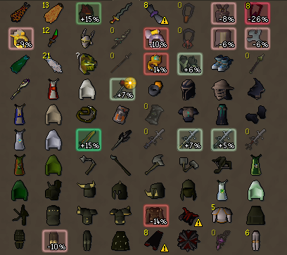
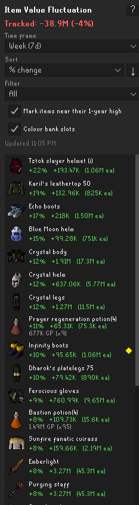
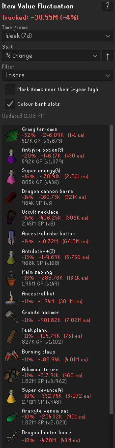
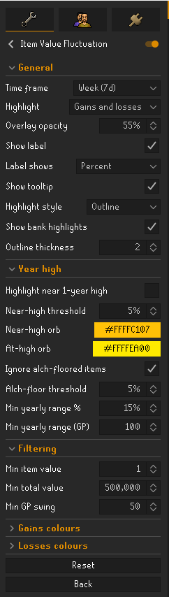

# Item Value Fluctuation

Ever opened your bank and wondered why your total jumped — or dropped — since yesterday or last
week? Item Value Fluctuation finds the culprits for you, lighting up the items whose prices have
swung the hardest so you can see at a glance what moved.

It turns your bank into a price-movement heatmap. Instead of colouring items by how much they are
worth, it colours them by **how much their price has moved** over a time window you choose — so a
staff that quietly jumped 25% this week lights up, while a 500M item that hasn't budged stays
neutral.

The goal: open your bank and immediately see whether anything you own has spiked (worth selling)
or crashed (maybe worth holding, maybe worth dumping).

## Features

- **Price-movement heatmap** over your whole bank — green for gains, red for losses, deeper colour
  for bigger moves.
- **Choose your window** — from the last 6 hours up to a full year.
- **Per-slot labels** showing the percent change, per-item GP, or whole-stack GP.
- **Hover tooltips** with the full breakdown: current price, start-of-window price, percent change,
  and the high/low over the window.
- **Movers side panel** — a sortable, filterable list of your biggest gainers and losers, so you
  don't have to scan the grid.
- **Optional "near 1-year high" orb** — marks items trading at or near their yearly peak, a
  separate "maybe worth selling" signal.
- **Smart pricing** — untradeable, combination and variant items are valued from their tradeable
  parts; coins and platinum tokens are left alone.
- **Noise filters** so cheap items and tiny stacks don't clutter the view.
- **Never touches your bank** — it only paints colour over the slots the game already laid out.

## Installation

Open the RuneLite client, go to the **Plugin Hub** (the wrench/configuration panel), search for
**Item Value Fluctuation**, and click install.

## How it works

- Each highlighted bank slot gets a translucent colour wash, an optional label, and a hover tooltip
  with the current price, the price at the start of the window, the percent change, and the high
  and low seen within the window.
- The slot label can show the percent change, the per-item GP change, or the whole stack's GP
  change (shortened as K/M/B), whichever you prefer.

## Movers side panel

A sidebar panel gives you the same information as a ranked list, which is handy when you want to
scan movers without hunting across the bank grid.

- **Sort** by percent change, GP change, item value, or name.
- **Filter** to show everything, only gainers, only losers, or only items near their 1-year high.
- Each row shows the item, its percent move, GP change, and current price; click a row for a detail
  card, and use the **?** header for a quick explanation of how values are worked out.
- A compact quick-settings strip lets you change the time frame and toggle the near-high orb
  without opening the full settings page.

## Time frames

Pick a profile; each maps to a lookback the prices API supports:

| Profile        | Window |
|----------------|--------|
| Aggressive     | 6h     |
| Day            | 24h    |
| Week (default) | 7d     |
| Month          | 30d    |
| Half-year      | 6m     |
| Year           | 1y     |

(6h is the shortest window the data source provides.)

## Colours

Defaults are tuned so most people never need to touch them. Deeper colour = bigger move.

**Gains:** pale green (≥5%) → green (≥10%) → bright green (≥15%) → bright purple (≥30%) → deep
purple (≥50%) → gold (≥100%, a moonshot — the item roughly doubled).

**Losses:** salmon (≥5%) → red (≥10%) → bright red (≥15%) → deep crimson (≥30%) → near-black
crimson (≥50%, a collapse).

You can switch between showing gains only, losses only, or both, and every threshold and colour is
configurable. Three filters keep the bank from turning into noise: a minimum per-item value, a
minimum total stack value, and a minimum GP swing — so a big percent move on a cheap item or a tiny
stack is ignored.

## Near 1-year high orb (optional)

Separate from the movement heatmap, there is an optional **gold orb** you can turn on (off by
default) that marks items trading at or near their highest instant-sell price over the past
**year**. Because this is a different signal from recent movement, it sits in the corner of the
slot and composes over the movement colour — an item can show a green movement fill *and* a gold
orb at the same time, and a flat item sitting at its yearly peak gets marked even with no movement
colour at all.

- An orb in the **near-high** colour means the current price is within a configurable percent (5%
  by default) of the 1-year high.
- An orb in the brighter **at-high** colour means the current price is **at or above** the 1-year
  high.

The orb uses the same per-item and total-value filters as the heatmap (it will not mark items that
fail those), but ignores the minimum-GP-swing filter and the gains/losses mode. It always uses the
1-year price history regardless of which movement time frame you have selected.

Note: the wiki price history only goes back one year, so this is a **1-year high, not an all-time
high**.

## How values are calculated

Short version: the plugin shows the **instant-sell price now** versus the **instant-sell price at
the start of your chosen window**, as a percentage.

The details, so the numbers aren't a mystery:

- **Data source.** Prices come from the
  [OSRS Wiki real-time prices API](https://oldschool.runescape.wiki/w/RuneScape:Real-time_Prices),
  the official RuneLite ↔ wiki feed — the same data RuneLite's own Grand Exchange features use.
- **Which price.** Values use the **instant-sell (low)** price: the honest "what could I actually
  get for this right now" number, not the higher instant-buy price.
- **Current price** is the live price for every item, fetched in a single request and refreshed
  every few minutes.
- **The "start of window" price** (the anchor the percentage is measured against) comes from the
  item's price history. It is the first data point in the window, so for a 7-day window it means
  "about 7 days ago", not to the exact second.
- **Near 1-year high (optional).** You can enable a gold orb on items trading at or near
  their highest instant-sell price over the past year — a "historically expensive, maybe worth
  selling" signal that is independent of the chosen time window and composes over the movement
  colour. By default this ignores **alch-floored items** (those whose GE price sits just above
  their high-alch value): alching keeps their price flat all year, so they would otherwise be
  marked permanently without being a real signal. You can turn that exclusion off if you want to
  see them.
- **Untradeable, combination and variant items are priced from their tradeable parts.** Degraded
  Barrows armour, ornament-kitted gear, a toxic blowpipe, crystal equipment, noted items and the
  like are valued as the sum of the Grand Exchange items they are made from, using RuneLite's own
  item mapping. The tooltip shows "Priced as …" or "Priced from N components" so it is clear when a
  value is derived this way. Coins and platinum tokens have a fixed value and never fluctuate, so
  they are never highlighted.
- **Loading.** To stay a good citizen with the free wiki API, price history is fetched gradually
  and cached, so colours fill in over a few seconds when you first open a large bank. A small
  "Updating …" line shows progress while this happens. History requests are drip-fed through a
  self-imposed cap of about 180 requests per minute (a steady trickle, not a burst), and a
  descriptive User-Agent with a GitHub contact is sent on every request. This cap is a courtesy
  guard rather than an official rule — the wiki publishes no rate limit and notes that trouble only
  starts with sustained multiple-large-queries-per-second traffic, which single-item lookups like
  these are not.

### Things to keep in mind

- **Thinly-traded items can be noisy.** If an item barely trades, a single unusual sale can swing
  its reported price, so a large percent move may reflect one odd transaction rather than a real
  market trend. The minimum-GP-swing filter helps, but treat big moves on low-volume items with
  care.
- **History is cached (up to ~30 minutes).** The current price is live, but the "start of window"
  anchor can be a little stale. This is unnoticeable for day/week/month windows and only matters on
  the 6h "Aggressive" setting during a fast-moving market.
- **Component prices are a sum of parts.** They do not account for charges or combination fees (for
  example, a charged blowpipe is valued as its tradeable parts). This is the standard approach for
  valuing these items and is the right signal for "did the value move", if not an exact resale
  figure.

## Settings

Everything has a sensible default, so the plugin works out of the box. The main options:

| Setting | What it does | Default |
|---|---|---|
| Time frame | The window price movement is measured over (6h → 1y) | Week |
| Highlight mode | Show gains only, losses only, or both | Both |
| Label content | Percent, per-item GP, or whole-stack GP on each slot | Percent |
| Overlay opacity | How strong the colour wash is | 55% |
| Min item value | Hide items worth less than this each | 1,000 GP |
| Min total value | Hide stacks worth less than this in total | 500,000 GP |
| Min GP swing | Hide moves smaller than this per item | 50 GP |
| Gain / loss colours & thresholds | Every tier colour and the percent it triggers at | Tuned defaults |
| Near 1-year high orb | Mark items at/near their yearly peak | Off |
| Near-high threshold | How close to the yearly high counts as "near" | 5% |
| Exclude alch-floored items | Skip items held flat by their high-alch value | On |

Open the plugin's settings in RuneLite to see the full list, grouped into general, filtering,
gains, losses, and year-high sections.

## Not a bank reorganiser

This plugin never moves, sorts, or reorders your bank — item order is controlled by the game. It
only paints colour over the slots the game already laid out. It injects no input and sends no
actions to the server.

## Changelog

### 1.1
- **Side panel stays up after you leave the bank** — keep an eye on your movers while skilling.
  Shows when it was last refreshed ("Updated …" live, "Bank as of …" once you walk away), and
  resets on logout.
- **New Outline highlight style, now the default** — a bright glowing border instead of a filled
  square, so you can still see what each item is. Adjustable thickness. The filled square is still
  available if you prefer it.
- **Stack counts stay readable** — item quantities are drawn on top of the highlight.
- **Show/hide bank highlights toggle** — don't want your bank coloured? Turn it off and still use
  the side panel.
- **"Tracked" total line** — the combined movement of the items currently shown.
- **"View on Wiki" link** on an item's detail view — opens its OSRS Wiki page for the full history.

## Licence

BSD 2-Clause. See [LICENSE](LICENSE).
